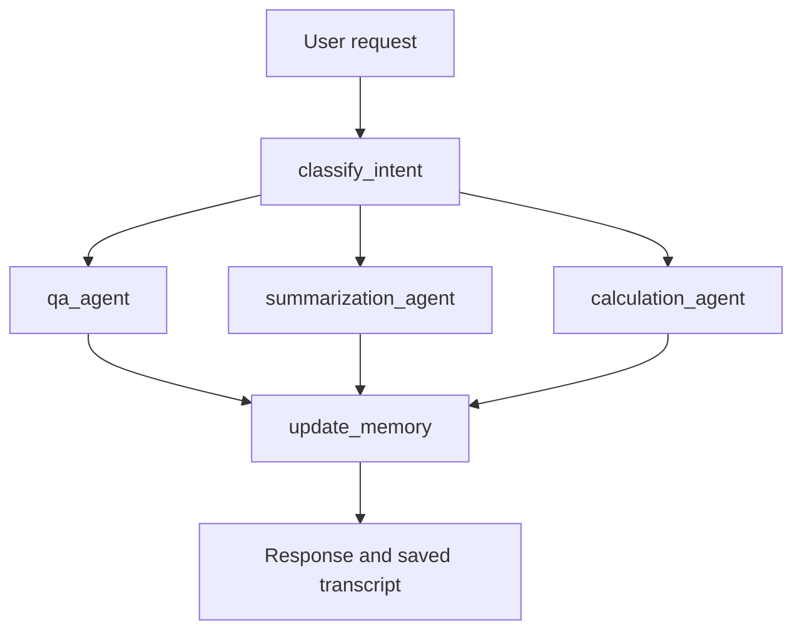

# Document Assistant

A Python document assistant built with LangGraph, LangChain, and OpenAI-compatible models for question answering, summarization, and arithmetic over local text documents.

The project demonstrates intent routing, tool calling, structured response models, and conversation sessions through a terminal interface, a Python API, and a Jupyter notebook.

## Features

- Routes requests to Q&A, summarization, or calculation nodes.
- Searches local documents with keyword matching and supplies up to three matching documents to the model.
- Provides document-reader and arithmetic-calculator tools.
- Uses Pydantic models for intent classification and responses.
- Saves conversation transcripts as JSON and keeps graph checkpoints in memory.
- Supports OpenAI and Vocareum through environment configuration.

This is an educational application. It has no embedding index, vector database, PDF parser, web interface, or HTTP API.

## Quick start

Run commands from the repository root in a Python virtual environment. Dependencies are listed in [requirements.txt](requirements.txt); the repository has no lockfile or declared minimum Python version. See the [installation guide](docs/QUICK_START.md) for compatibility notes.

```bash
git clone https://github.com/robertishimurasousa/Doc-Assistant-Project.git
cd Doc-Assistant-Project
python3 -m venv .venv
source .venv/bin/activate
python -m pip install -r requirements.txt
cp .env.example .env
```

For direct OpenAI access, edit `.env`:

```dotenv
API_PROVIDER=openai
OPENAI_API_KEY=your-api-key
DEFAULT_MODEL=gpt-4
DEFAULT_TEMPERATURE=0
```

Remove the copied `OPENAI_BASE_URL` line when using direct OpenAI access. For a course-provided key, follow [Vocareum setup](docs/VOCAREUM_SETUP.md). The model above is the code default; the selected model must be available to your account and support tool calling.

Start with one bundled sample:

```bash
python main.py data/sales_report_q1_2024.txt
```

Try:

```text
What does the Q1 sales report say about monthly revenue?
Summarize the Q1 sales report.
Calculate 50000 + 60000 + 70000.
/stats
/quit
```

Answers depend on the configured model. Without a configured LLM, document and session management remain available, but queries return configuration messages rather than document answers.

## Interfaces

### Terminal

```bash
python main.py ./data
python main.py
```

Directory loading recursively includes lowercase `.txt`, `.md`, `.json`, and `.csv` files as UTF-8 text. Loading `data/` also includes its README.

| Command | Action |
| --- | --- |
| `/load <path>` | Append documents from a file or directory. |
| `/stats` | Display document and session counts. |
| `/sessions` | List saved session IDs. |
| `/clear` | Start a new conversation; saved transcripts remain on disk. |
| `/help` | Display command help. |
| `/quit` or `/exit` | Exit the application. |

Session restoration is available through the Python API.

### Python

```python
from src.assistant import DocumentAssistant
from src.config import get_default_llm

assistant = DocumentAssistant(
    document_path="data/sales_report_q1_2024.txt",
    llm=get_default_llm(),
)
assistant.load_documents()
print(assistant.query("What does the report say about monthly revenue?"))
```

`query()` returns a string. Q&A returns answer text; calculation and summarization currently return string representations of their response models. See the [API reference](docs/API_REFERENCE.md) for structured state access.

### Notebook

The [interactive demo](notebooks/document_assistant_demo.ipynb) walks through queries, tools, and sessions. Follow the [notebook guide](notebooks/README.md) for kernel and working-directory setup.

## Architecture



Each specialist asks the model for tool calls, executes the returned calls once, and generates a response. Calculator use is requested by the prompt but is not enforced by the graph. Source fields can contain tool names, and confidence values are not calibrated accuracy measures.

Read the [architecture guide](docs/IMPLEMENTATION.md) for execution and memory details.

## Repository layout

```text
.
├── main.py              # Interactive terminal entry point
├── src/                 # Assistant, workflow, retrieval, tools, schemas, prompts
├── data/                # Five sample documents and their documentation
├── docs/                # Setup, reference, architecture, and historical notes
├── notebooks/           # Interactive demonstration
├── tests/               # Automated tests and manual demonstrations
├── sessions/            # JSON conversation transcripts
├── .env.example         # Configuration template
├── pyproject.toml       # Pytest and coverage configuration
└── requirements.txt     # Runtime, notebook, and test dependencies
```

## Documentation

- [Documentation index](docs/README.md)
- [Installation and first query](docs/QUICK_START.md)
- [Configuration reference](docs/CONFIGURATION.md)
- [Python API reference](docs/API_REFERENCE.md)
- [Architecture and implementation](docs/IMPLEMENTATION.md)
- [Testing guide](docs/TESTING_GUIDE.md)
- [Troubleshooting](docs/TROUBLESHOOTING.md)
- [Contributing](CONTRIBUTING.md)
- [Project description and GitHub topics](docs/PROJECT_METADATA.md)

## Development

Run the focused offline suite:

```bash
python -m pytest tests/test_schemas.py tests/test_agents.py tests/test_agent_logic.py -o addopts=""
```

This runs assertions without the default coverage options. The 57 selected tests passed in the documentation validation, but their 39.50% coverage is below the configured 50% threshold. Other files in `tests/` include manual demonstrations that may call the provider. Read the [testing guide](docs/TESTING_GUIDE.md) for the full distinction.

## Data handling and project status

Retrieved text and recent conversation history are sent to the configured provider. Transcripts are stored as plaintext JSON. Review generated session files before committing.

The repository does not currently contain a `LICENSE` file. Earlier course and implementation notes are retained under `docs/` and identified in the documentation index.
