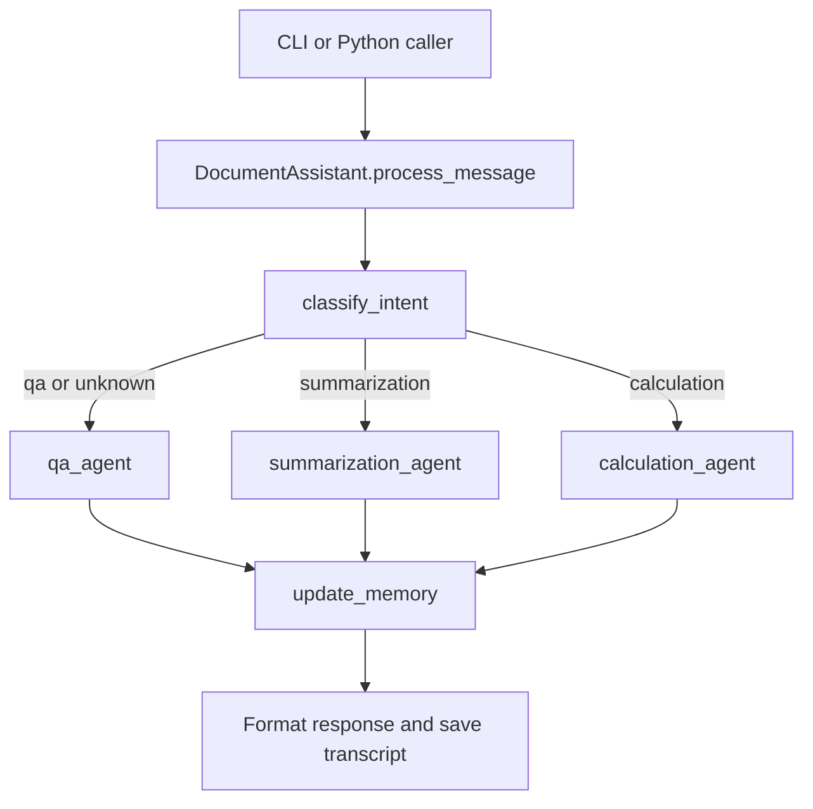

# Architecture and implementation

The assistant is a synchronous Python application. [main.py](../main.py) provides the terminal interface; [DocumentAssistant](../src/assistant.py) connects retrieval, graph execution, and transcript storage.

## Module map

| Module | Responsibility |
| --- | --- |
| [assistant.py](../src/assistant.py) | Public API, session lifecycle, query invocation, and string output. |
| [agent.py](../src/agent.py) | Graph state, intent classification, specialist nodes, and memory updates. |
| [retrieval.py](../src/retrieval.py) | UTF-8 document loading and keyword ranking. |
| [tools.py](../src/tools.py) | Calculator, document reader, helper registry, and tool logging. |
| [schemas.py](../src/schemas.py) | Pydantic document, session, intent, and response models. |
| [prompts.py](../src/prompts.py) | Task instructions and prompt helpers. |
| [config.py](../src/config.py) | Environment loading and ChatOpenAI construction. |

## Request lifecycle

1. The assistant creates a session if needed and records the user message.
2. It supplies prior transcript messages and per-turn state to the graph, with the session ID as `thread_id`.
3. Classification uses `UserIntent` structured output. Unknown intents route to Q&A.
4. A specialist requests tool calls, executes each returned call, and generates its final response.
5. The memory node requests a conversation summary and active document IDs.
6. The assistant formats the response as a string, records it, and attempts to save the transcript.

A normal model-backed turn uses four model invocations: classification, tool selection, final response, and memory summary. Retries or failures may change the actual request count.

Without an LLM, classification falls back to keyword rules. Specialist nodes return configuration messages; this mode does not generate document answers.

## Retrieval

Each file becomes one `Document`. Directory loading recursively selects lowercase `.txt`, `.md`, `.json`, and `.csv` files; a directly supplied file is attempted regardless of extension.

Retrieval lowercases the query, splits it on whitespace, and adds substring occurrence counts for each term in each document. Only positive-score documents are returned, sorted by descending score.

The retriever defaults to five results. The agent's `document_reader` requests three and returns their full contents with source paths. There is no chunking, token-budget enforcement, semantic search, or filter application. JSON and CSV receive no format-specific parsing. Loading appends documents without deduplication.

## Tools and response generation

All specialists receive both `calculator` and `document_reader`. The model selects tool calls; Python executes them. Results are inserted into a fresh prompt as text rather than retained as native tool-message exchanges.

There is only one tool-selection round per specialist. A calculator call cannot be planned in a second round using newly retrieved data. Prompts request calculator use, but no graph condition requires it.

| Route | Final response construction |
| --- | --- |
| Q&A | Plain LLM response wrapped in `AnswerResponse` by Python. |
| Summarization | `with_structured_output(SummarizationResponse, method="function_calling")`. |
| Calculation | `with_structured_output(CalculationResponse, method="function_calling")`. |

Q&A `sources` contains tool names. Other routes may fall back to tool names when source/document fields are empty. These fields are not a verified citation index.

Confidence is constrained to 0–1, but some values are assigned or replaced by application heuristics. Schema validity does not establish factual correctness.

The calculator permits numeric arithmetic characters and evaluates the expression with empty builtins. It supports `+`, `-`, `*`, `/`, `//`, `%`, `**`, decimal points, and parentheses. It has no expression-size, CPU, or memory limit.

## State and persistence

`GraphState` is a `Dict` subclass with annotated fields. `messages` and `actions_taken` use `operator.add` reducers. The separate Pydantic `AgentState` model is not the graph's runtime state schema.

| Storage | Contents | Lifetime |
| --- | --- | --- |
| Graph `MemorySaver` | Checkpoints keyed by thread/session ID | Current workflow instance in memory. |
| `Session` | User/assistant messages and metadata | Current assistant instance. |
| `sessions/<id>.json` | Serialized transcript and metadata | On disk until removed. |
| Retriever | Loaded documents | Current assistant instance. |

Loading a session restores its transcript, not graph checkpoints or documents. Reload documents separately after restarting.

Every query resubmits previous transcript messages to an additive graph field, which can duplicate history across checkpoints. It also resets `conversation_summary` and `active_documents` before invocation. Specialists primarily use the last five history messages; classification receives the graph's history. The generated summary is not injected as durable context for subsequent specialist prompts.

## Current boundaries

- The public query API returns strings; summary and calculation models are stringified.
- Workflow exceptions become error strings and can be saved as assistant messages.
- A failed transcript save is reported, but its boolean result does not change the query return value.
- There is no authentication, HTTP server, shared database, or production deployment configuration.
- Document contents and conversation history enter provider prompts; transcripts are plaintext.

See [API reference](API_REFERENCE.md), [testing](TESTING_GUIDE.md), and [troubleshooting](TROUBLESHOOTING.md).
